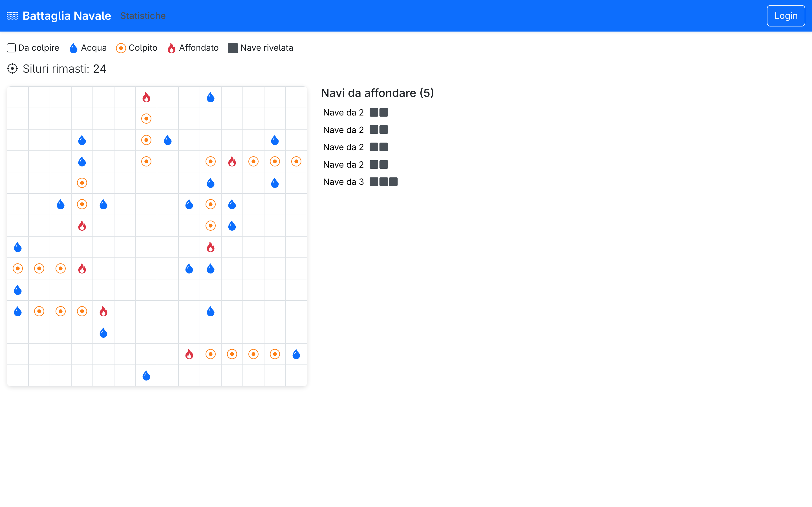

# Progetto Applicazioni Web 1: "Battaglia Navale"

## Route dell'applicazione React

- Route `/`: homepage con i pulsanti Casual e Torneo. Casual (solo per utenti non autenticati) apre il selettore di difficoltà e avvia la partita su `/game/casual`. Torneo, invece, porta alla `/dashboard` se autenticati, altrimenti invita a fare il login. La navbar mostra sempre Statistiche e, in alto a destra, il pulsante Login o Logout.
- Route `/login`: pagina di login con un form per username e password. Dopo il login riuscito l'utente viene reindirizzato alla homepage.
- Route `/dashboard`: pagina dei tornei, accessibile solo agli utenti autenticati. Il giocatore può creare un nuovo torneo scegliendo la difficoltà e ricevendo un codice condivisibile, oppure unirsi a uno esistente inserendo il codice. In entrambi i casi viene poi reindirizzato a `/game/:id`.
- Route `/game/:id`: griglia di gioco, utilizzata sia per le partite Casual (id fisso "casual", stato in sessione) sia per le partite Torneo (id numerico, stato nel DB). Mostra la griglia, la legenda di gioco, i siluri rimanenti, l'elenco delle navi e il risultato di ogni lancio. Le posizioni complete delle navi vengono rivelate solo al termine della partita tramite una chiamata separata a `GET /api/games/:id/ships`.
- Route `/stats` (e `/stats/:level`): pagina delle statistiche, pubblica e accessibile a chiunque tramite il pulsante Statistiche nella navbar. Mostra, per ogni giocatore e per ogni livello di difficoltà, le partite giocate, vinte, perse e la percentuale di vittorie. Una barra di filtri permette di vedere tutti i livelli insieme (`/stats`) oppure un solo livello (`/stats/:level`, per esempio `/stats/Facile`).
- Route `*`: catch-all, reindirizza a `/`.

## API Server

### Riepilogo

- Login: POST `/api/sessions`
- Ottieni la sessione corrente: GET `/api/sessions/current`
- Logout: DELETE `/api/sessions/current`
- Avvia una partita Casual: POST `/api/games`
- Crea un torneo: POST `/api/tournaments`
- Entra in un torneo: POST `/api/tournaments/:code/join`
- Ottieni lo stato di una partita: GET `/api/games/:id`
- Lancia un siluro: POST `/api/games/:id/shots`
- Ottieni le posizioni delle navi (solo a fine partita): GET `/api/games/:id/ships`
- Ottieni le statistiche dei giocatori (pubblica): GET `/api/stats`

---

### Login

URL: `/api/sessions`

Metodo HTTP: POST

Descrizione: autentica un utente e crea una nuova sessione.

Body della Request:
```json
{
  "username": "alice",
  "password": "alice123"
}
```

Response: `200 OK` (successo) o `401 Unauthorized` (credenziali errate).

Body della Response:
```json
{
  "id": 1,
  "username": "alice"
}
```

---

### Ottieni la sessione corrente

URL: `/api/sessions/current`

Metodo HTTP: GET

Descrizione: verifica se l'utente è ancora loggato e restituisce le sue informazioni.

Body della Request: nessuno

Response: `200 OK` (successo) o `401 Unauthorized` (non autenticato).

Body della Response:
```json
{
  "id": 1,
  "username": "alice"
}
```

---

### Logout

URL: `/api/sessions/current`

Metodo HTTP: DELETE

Descrizione: distrugge la sessione corrente.

Body della Request: nessuno

Response: `200 OK` (successo).

Body della Response: nessuno

---

### Avvia una partita Casual

URL: `/api/games`

Metodo HTTP: POST

Descrizione: avvia una nuova partita Casual per un utente anonimo. Il server genera casualmente le posizioni delle navi e le conserva nella sessione Express. Le posizioni non vengono mai inviate al client. Restituisce l'ID fisso "casual" come identificatore di partita. Richiede che l'utente non sia autenticato.

Body della Request:
```json
{
  "difficulty": "Facile"
}
```

Response: `201 Created` (successo), `401 Unauthorized` (utente già autenticato), `422 Unprocessable Entity` (errore di validazione) o `500 Internal Server Error` (errore nella creazione della partita).

Body della Response:
```json
{
  "gameId": "casual",
  "gridSize": 7,
  "ships": 
  [
    { "size": 2 }, 
    { "size": 2 }, 
    { "size": 3 }, 
    { "size": 3 }
  ],
  "torpedoesRemaining": 18,
  "status": "attivo",
  "shots": []
}
```

---

### Crea un torneo

URL: `/api/tournaments`

Metodo HTTP: POST

Descrizione: crea un nuovo torneo. Il server genera casualmente le posizioni delle navi, le salva nel database, restituisce un codice univoco condivisibile e crea immediatamente una partita per il creatore. Richiede autenticazione.

Body della Request:
```json
{
  "difficulty": "Intermedio"
}
```

Response: `201 Created` (successo), `401 Unauthorized` (non autenticato), `422 Unprocessable Entity` (errore di validazione) o `500 Internal Server Error` (errore nella creazione del torneo).

Body della Response:
```json
{
  "code": "XKCD42",
  "gameId": 7,
  "gridSize": 10,
  "ships": 
  [
    { "size": 2 }, 
    { "size": 2 }, 
    { "size": 3 }, 
    { "size": 3 }, 
    { "size": 4 }, 
    { "size": 4 }, 
    { "size": 5 }
  ],
  "torpedoesRemaining": 28,
  "status": "attivo",
  "shots": []
}
```

---

### Entra in un torneo

URL: `/api/tournaments/:code/join`

Metodo HTTP: POST

Descrizione: entra in un torneo esistente tramite il codice nell'URL. Viene creata una nuova partita per l'utente corrente con le stesse posizioni delle navi, la stessa griglia e la stessa difficoltà del creatore. Richiede autenticazione.

Body della Request: nessuno

Response: `201 Created` (successo), `401 Unauthorized` (non autenticato), `404 Not Found` (codice non esistente), `409 Conflict` (l'utente ha già una partita in questo torneo) o `500 Internal Server Error` (errore nell'adesione al torneo).

Body della Response:
```json
{
  "gameId": 8,
  "gridSize": 10,
  "ships": 
  [
    { "size": 2 }, 
    { "size": 2 }, 
    { "size": 3 }, 
    { "size": 3 }, 
    { "size": 4 }, 
    { "size": 4 }, 
    { "size": 5 }
  ],
  "torpedoesRemaining": 28,
  "status": "attivo",
  "shots": []
}
```

---

### Ottieni lo stato di una partita

URL: `/api/games/:id`

Metodo HTTP: GET

Descrizione: restituisce lo stato attuale di una partita, inclusi tutti i siluri lanciati finora. Per le partite Casual (id = "casual") legge dalla sessione, mentre per le partite Torneo (id numerico) legge dal DB e richiede autenticazione e proprietà della partita. Le posizioni delle navi non vengono mai incluse in questa risposta. Per vedere le posizioni delle navi a fine partita usare `GET /api/games/:id/ships`.

Body della Request: nessuno

Response: `200 OK` (successo), `401 Unauthorized` (non autenticato, solo Torneo), `404 Not Found` (partita non trovata o non accessibile) o `500 Internal Server Error` (errore nel recupero della partita).

Body della Response:
```json
{
  "gridSize": 10,
  "ships": 
  [
    { "size": 2 }, 
    { "size": 3 }
  ],
  "torpedoesRemaining": 25,
  "status": "attivo",
  "shots": 
  [
    { 
      "row": 1, 
      "col": 3, 
      "result": "acqua" 
    },
    { 
      "row": 4, 
      "col": 7, 
      "result": "colpito" 
    }
  ]
}
```

---

### Lancia un siluro

URL: `/api/games/:id/shots`

Metodo HTTP: POST

Descrizione: lancia un siluro su una cella della partita specificata. Per le partite Casual legge e aggiorna lo stato dalla sessione, mentre per le partite Torneo richiede autenticazione e proprietà della partita.

Body della Request:
```json
{
  "row": 3,
  "col": 5
}
```

Response: `200 OK` (successo), `400 Bad Request` (partita non attiva o cella già colpita), `401 Unauthorized` (non autenticato, solo Torneo), `404 Not Found` (partita non trovata o non accessibile), `422 Unprocessable Entity` (errore di validazione, ad esempio coordinate mancanti o fuori dalla griglia) o `500 Internal Server Error` (errore nel lancio del siluro).

Body della Response:
```json
{
  "result": "colpito",
  "torpedoesRemaining": 24,
  "status": "attivo"
}
```

---

### Ottieni le posizioni delle navi

URL: `/api/games/:id/ships`

Metodo HTTP: GET

Descrizione: restituisce le posizioni complete di tutte le navi. Risponde `400 Bad Request` se la partita è ancora in corso, poiché le posizioni vengono rivelate solo a fine partita. Per le partite Casual legge dalla sessione, mentre per le partite Torneo richiede autenticazione e proprietà della partita.

Body della Request: nessuno

Response: `200 OK` (successo), `400 Bad Request` (partita ancora in corso), `401 Unauthorized` (non autenticato, solo Torneo), `404 Not Found` (partita non trovata o non accessibile) o `500 Internal Server Error` (errore nel recupero delle navi).

Body della Response:
```json
[
  { 
    "row": 0, 
    "col": 0, 
    "size": 2, 
    "dir": "H" 
  },
  { 
    "row": 3, 
    "col": 2, 
    "size": 3, 
    "dir": "V" 
  }
]
```

---

### Ottieni le statistiche dei giocatori

URL: `/api/stats`

Metodo HTTP: GET

Descrizione: restituisce le statistiche di tutti i giocatori, suddivise per giocatore e per livello di difficoltà. È una route pubblica, accessibile anche dagli utenti non autenticati.

Body della Request: nessuno

Response: `200 OK` (successo) o `500 Internal Server Error` (errore nel recupero delle statistiche).

Body della Response:
```json
[
  { 
    "username": "alice",
    "difficulty": "Facile", 
    "played": 3, 
    "won": 2, 
    "lost": 1, 
    "winPct": 66.7 
  },
  { 
    "username": "bob",
    "difficulty": "Intermedio", 
    "played": 1, 
    "won": 0, 
    "lost": 1, 
    "winPct": 0.0 
  }
]
```

---

## Tabelle del database

- `users`: contiene i tre utenti pre registrati. Colonne: id, username, password, salt.
- `tournaments`: una riga per ogni torneo creato. Colonne: id, code, difficulty, grid_size, ships, created_at. Le posizioni sono conservate solo qui e non vengono mai inviate al client durante una partita attiva.
- `games`: una riga per ogni partita Torneo di ogni utente. Colonne: id, user_id, tournament_id, torpedoes_remaining, status, created_at.
- `shots`: una riga per ogni siluro lanciato in una partita Torneo. Colonne: id, game_id, row, col, result, shot_at.

### Livelli di difficoltà

| Difficoltà  | Griglia | Navi (dimensioni e numero)                       | Siluri |
|-------------|---------|----------------------------------------|--------|
| Facile      | 7×7     | [2, 2, 3, 3] - 4 navi                 | 18     |
| Intermedio  | 10×10   | [2, 2, 3, 3, 4, 4, 5] - 7 navi        | 28     |
| Difficile   | 14×14   | [2, 2, 2, 2, 3, 3, 3, 4, 4, 4, 5, 5] - 12 navi   | 45     |

## Componenti React

- NavHeader (in `NavHeader.jsx`): barra di navigazione che mostra il pulsante Login in alto a destra quando l'utente non è autenticato e i pulsanti Logout e Statistiche quando è autenticato.
- LoginForm (in `AuthComponents.jsx`): form di login con validazione client-side.
- HomePage (in `HomePage.jsx`): schermata principale con i pulsanti Casual e Torneo. Mostra il selettore di difficoltà quando si clicca Casual. Se non autenticato e si clicca Torneo, mostra un messaggio che invita al login.
- Dashboard (in `Dashboard.jsx`): pagina dei tornei per utenti autenticati. Permette di creare un nuovo torneo e ricevere un codice condivisibile, oppure di unirsi a uno esistente inserendo il codice.
- GameBoard (in `GameBoard.jsx`): griglia NxN interattiva che mostra le celle acqua, colpito e affondato e gestisce i click per lanciare i siluri.
- ShipList (in `ShipList.jsx`): elenco delle navi ancora da affondare, ognuna con la sua dimensione. Quando una nave affonda sparisce dalla lista: il client ne deduce la dimensione dalle celle colpite con esito 'affondato', senza mai ricevere le posizioni dal server.
- StatsTable (in `StatsTable.jsx`): tabella delle statistiche suddivisa per giocatore e per livello di difficoltà. Legge il livello selezionato dall'URL e mostra tutte le tabelle o solo quella del livello scelto.
- Filters (in `Filters.jsx`): barra di filtri per livello di difficoltà nella pagina delle statistiche. Ciascun filtro è un NavLink che naviga a `/stats` o `/stats/:level` ed evidenzia da solo il filtro attivo.

## Screenshot



## Credenziali utenti

| Username | Password   |
|----------|------------|
| alice    | alice123   |
| bob      | bob123     |
| charlie  | charlie123 |

alice e bob hanno già giocato delle partite (sia vinte che perse), mentre charlie non ha ancora giocato.

## Uso di strumenti AI

Durante lo sviluppo del progetto ho fatto uso di uno strumento AI, che mi ha aiutato in questi quattro punti:

1. Creazione del database: mi ha aiutato a definire lo schema delle tabelle e i dati iniziali (i tre utenti e le partite già giocate) presenti nel database fornito.
2. Logica di posizionamento delle navi: mi ha dato una base iniziale da cui partire per l'algoritmo che dispone le navi sulla griglia, rispettando il vincolo di non adiacenza, che ho poi sviluppato e adattato.
3. Gestione della griglia di gioco: mi ha aiutato nella parte del client che costruisce e aggiorna la griglia in base agli esiti dei tiri (acqua, colpito e affondato) e nella logica di visualizzazione.
4. Refactoring: mi ha supportato in alcune operazioni di pulizia e riorganizzazione del codice, per esempio raccogliendo porzioni ripetute in funzioni helper e uniformando lo stile del codice.
